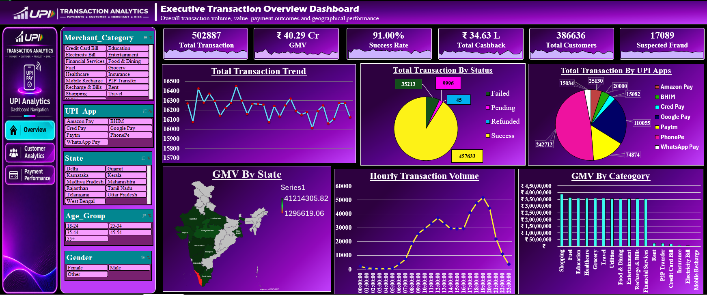
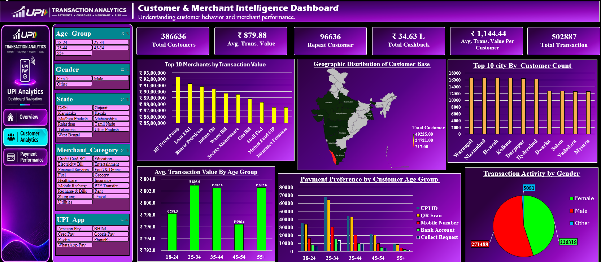
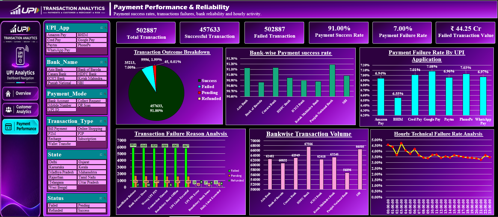

# UPI Transaction Analytics | Excel & SQL

### End-to-End Data Analysis Project

An end-to-end analysis of UPI transaction data using Microsoft Excel and MySQL to understand transaction performance, customer behaviour, merchant activity and payment reliability.

---

## Project Overview

Digital payments generate a large amount of transactional data, but understanding what happens behind those transactions is what makes the data valuable.

For this project, I worked with a UPI transaction dataset containing **502,887 transaction records and 26 columns** covering transaction details, customer demographics, merchant information, payment applications, banking partners and transaction outcomes.

The objective was to explore the dataset, identify meaningful business patterns, investigate payment failures and turn the findings into interactive Excel dashboards supported by SQL analysis.

I divided the project into three major analytical areas:

1. Executive Transaction Overview
2. Customer & Merchant Intelligence
3. Payment Performance & Reliability

## Project Objectives

- Understand overall transaction volume and transaction value.
- Evaluate transaction success, failure, pending and refund rates.
- Identify applications and banks with relatively higher failure rates.
- Investigate transaction failure reasons and hourly patterns.
- Understand customer demographics and repeat transaction behaviour.
- Identify high-performing merchants and transaction categories.
- Examine suspected fraud flags and transaction risk indicators.
- Translate analytical findings into business-focused dashboards.

## Dataset Information

| Description | Details |
|---|---|
| Dataset | UPI Transaction Dataset |
| Total Records | 502,887 |
| Total Columns | 26 |
| Unique Customers | 386,636 |
| Observation Period | May 2026 |
| Database | MySQL |
| Visualization | Microsoft Excel |

**Dataset Source:** (Upi Transaction data with dashboards.xlsx)

The full raw workbook is not included in this repository because of its file size. Refer to the `data/README.md` file for dataset access information.

## Tools & Technologies

- **Microsoft Excel:** Data exploration, data preparation, Pivot Tables, Pivot Charts, KPI calculations, slicers and interactive dashboards.
- **MySQL:** Data validation, aggregation, filtering, conditional calculations, customer segmentation and business analysis.
- **GitHub:** Version control, SQL documentation and project presentation.

## Dashboard Overview

### 1. Executive Transaction Overview

This dashboard provides a high-level view of overall transaction performance.

Key areas covered:

- Total transaction volume
- Gross transaction value
- Transaction success rate
- Total cashback
- Suspected fraud flags
- Daily transaction trends
- Transaction status distribution
- UPI application contribution
- State-wise transaction value
- Hourly transaction volume
- Category-wise transaction value

### 2. Customer & Merchant Intelligence

This dashboard explores customer demographics, merchant performance and geographical distribution.

Key areas covered:

- Total unique customers
- Repeat customer analysis
- Average transaction value
- Customer age-group analysis
- Gender-based transaction activity
- State-wise customer distribution
- Top cities by customer count
- Top merchants by transaction value
- Customer payment preferences

### 3. Payment Performance & Reliability

This dashboard focuses on payment outcomes and the reliability of different payment channels.

Key areas covered:

- Successful and failed transactions
- Payment success and failure rates
- Bank-wise payment success rate
- UPI application failure rate
- Transaction failure reason analysis
- Bank-wise transaction volume
- Hourly technical failure analysis

## Key Findings

The initial Excel analysis produced the following results:

| Metric | Result |
|---|---:|
| Total Transactions | 502,887 |
| Unique Customers | 386,636 |
| Successful Transactions | 457,633 |
| Failed Transactions | 35,213 |
| Pending Transactions | 9,996 |
| Refunded Transactions | 45 |
| Transaction Success Rate | 91.00% |
| Transaction Failure Rate | 7.00% |
| Total Transaction Value | ₹44.25 Cr |
| Successful Transaction Value | ₹40.29 Cr |
| Average Transaction Value | ₹879.88 |
| Total Cashback | ₹34.63 L |
| Repeat Customers | 96,636 |
| Repeat Customer Percentage | 24.99% |
| Suspected Fraud Flags | 17,089 |

### Business Observations

- Approximately 91% of recorded transactions were successful.
- Failed transactions accounted for approximately 7% of the overall transaction volume.
- PhonePe recorded the highest transaction volume among the applications in the dataset.
- HDFC Bank recorded the highest transaction volume among the listed banks.
- Transaction activity was highest during the evening, with 7 PM recording 51,861 transactions.
- Repeat customers accounted for approximately 25% of unique customers.
- The suspected fraud indicator flagged approximately 3.40% of transaction records.

These findings are descriptive results from the available dataset and should not be interpreted as proof of causation.

## SQL Business Analysis

The SQL component investigates business questions that complement the Excel dashboards.

### Transaction Performance
- What is the daily transaction volume and transaction value?
- Which dates experienced the highest failure rate?
- What percentage of transactions fall under each status?
- Which transaction categories generate the highest successful transaction value?
- How does average transaction value vary by transaction type?

### Payment Reliability
- Which UPI application has the highest failure rate?
- Which banking partner has the lowest success rate?
- Which payment mode experiences the highest failure rate?
- During which hours are technical failures most frequent?
- What are the leading contributors to failed transactions?
- Which banks experience the highest failed transaction amount?

### Customer Intelligence
- Who are the top 10 customers by successful transaction value?
- What percentage of customers are repeat customers?
- Which age group contributes the highest transaction value?
- How do payment preferences differ across age groups?
- Which states contribute the highest number of unique customers?

### Merchant & Risk Analysis
- Which merchants generate the highest successful transaction value?
- Which risk-score ranges contain the highest proportion of suspected fraud flags?

Detailed SQL queries and their outputs are documented in the `sql/` directory.

## Data Quality & Validation

The project includes checks for:

- Missing and null values
- Duplicate transaction identifiers
- Invalid transaction amounts
- Transaction status consistency
- Successful transaction amount consistency
- Date and time validity
- Customer and transaction count reconciliation

Only validated issues and actual cleaning actions will be reported in the final data-quality summary.

## What I Learned

Working on this project helped me strengthen my understanding of transaction-level data, Excel-based analysis and SQL business queries.

It also gave me practical experience in translating raw transactional records into meaningful business insights, identifying payment performance patterns and presenting findings through interactive dashboards.

## Future Improvements

- Add more detailed customer segmentation.
- Investigate high-risk transaction patterns.
- Build a more comprehensive customer retention analysis.
- Compare transaction performance across additional periods.
- Expand payment reliability analysis using SQL.
- Develop automated reporting for recurring analysis.

---

**Project Status:** Excel dashboards completed. SQL analysis and final data-quality documentation to be completed and validated.

**Author:** [Your Name]

**Skills:** Microsoft Excel | MySQL | Data Analysis | Business Intelligence | Data Visualization
